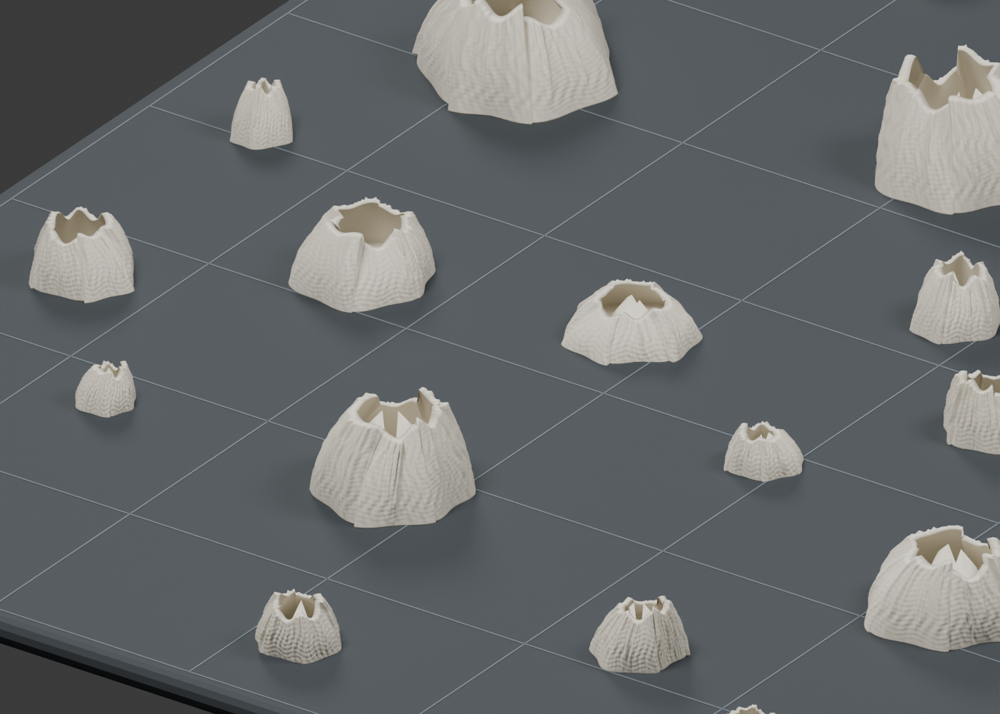

# 藤壶打印盘 · Barnacle Print Kit

50 颗大小、形态不同的藤壶，分布在 **200 × 200 毫米**范围内，**最高 15 毫米**。每颗独立、底面平整，没有共同打印底板。目标是做出可逐颗从打印平台取下的藤壶群落。

> 上图由最终打印模型渲染，并非实物照片。作品是本地重建的自然风格造型，不是生物扫描，也不是 TRELLIS.2 导出的模型。已做文件检查，尚未实际打印；真实感、细节和取下时的手感仍需实物确认。

## 下载打印文件

- [完整打印包：整盘、50 颗单体、三颗试打、Blender 文件](https://github.com/iotbarry/barnacle-print-kit/releases/download/v1.0.0/barnacles-15mm-print-files.zip)
- [网页预览包：解压后用本地服务打开](https://github.com/iotbarry/barnacle-print-kit/releases/download/v1.0.0/barnacles-15mm-viewer.zip)
- [先试打三颗](models/three-samples-15mm.stl)
- [所有发布文件与校验信息](https://github.com/iotbarry/barnacle-print-kit/releases/tag/v1.0.0)

完整模型文件较大，放在 Releases 中；下载仓库的 ZIP 不包含全部模型。

## 尺寸与使用

| 项目 | 最终版本 |
| --- | --- |
| 数量 | 50 颗独立藤壶 |
| 摆放区域 | 200 × 200 mm |
| 实际外包尺寸 | 约 185.661 × 187.552 × 15.000 mm |
| 最高点 | 15.000 mm |
| 整体缩小比例 | 原版各颗长宽高同时乘 0.5033557176 |
| 颗粒间最小平面间距 | 约 7.736 mm |
| 实物试打 | 未完成 |

导入切片软件时选择毫米、100% 大小。先使用三颗试打文件确认薄边和细节，再打印整盘。不要把展示用深色底板当成打印内容。剥离手感受材料、平台和打印设置影响，这份文件不保证特定手感。

## 制作资料

1. [完整制作过程与来源](docs/workflow.md)：每一轮为什么调整、最终模型来自哪里。
2. [提示词工程](docs/prompt-engineering.md)：原始提示词、约束拆解、失败经验和最终 15 mm 任务模板。
3. [实际使用的 skills 和软件](docs/skills.md)：区分真正用过、仅评估过以及普通软件。
4. [从源文件重新制作](docs/reproduce.md)：安装、生成、检查和预览。
5. [文件清单及检查结果](reports/)：原文件指纹、尺寸、此次公开前的检查。
6. [使用与第三方说明](NOTICE.md)。

代码和资料以中文为主。无需 AI 服务账号即可在本地重建最终几何；历史 AI 尝试只是设计参考。
