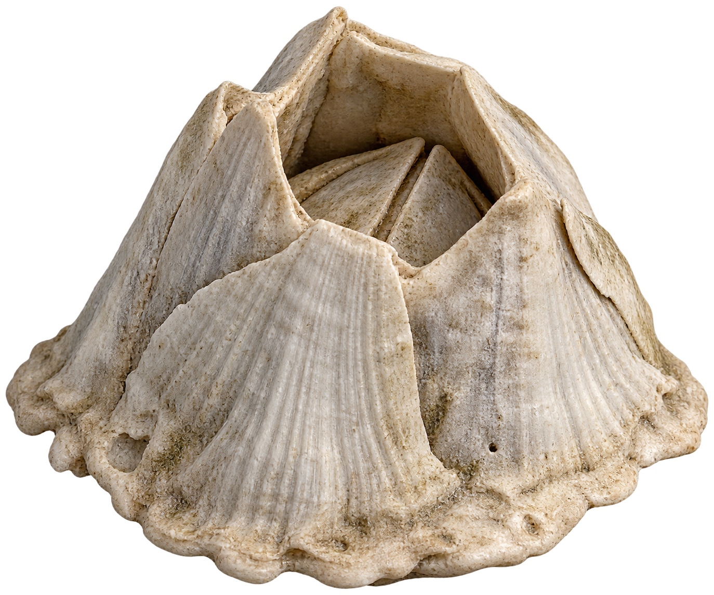
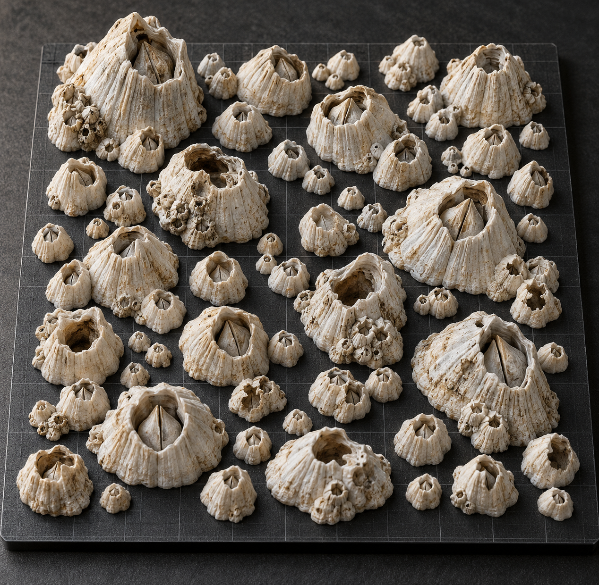

# 提示词工程

本页区分实际执行的原始提示和为复用整理的模板；不把后来写的模板说成历史执行记录。

## 1. 需求约束先行

- 外观：大小、倾斜、壳口、壳片边缘和纹理各不相同，避免整齐复制。
- 生物特征：不等宽钙质壳片、不规则开口、纵向细肋、生长痕迹及磨损边缘。
- 布局：有大有小、自然分布、各颗分离，没有共同底板。
- 打印：平底、封闭实体、毫米单位、在 200 × 200 mm 内；最终最高 15 mm。
- 验收：必须读回真正导出的文件，不能只看图片或脚本里的数字。

## 2. 实际执行的图片提示

[单颗完整英文提示](../prompts/01-image-reference.txt)用于图生三维的输入，透明背景、一个主体、三分之四视角、六片不等壳片、深腔与小盖板。去掉岩石、动物、地面、文字和投影，减少背景被当成模型的机会。



[整盘完整英文提示](../prompts/02-image-reference.txt)用于表达群落风格，要求大小、形态和损伤差异，避免花盆、南瓜、均匀正弦纹理。**这条历史提示仍写最高 30 mm、约 45 颗；当前模型是 50 颗、最高 15 mm，不可混用。**



图像生成工具接受 prompt 与 transparent_background；单颗设为 true，整盘设为 false。记录中没有可核实的底层模型名称，所以不猜测具体图像模型版本。

## 3. 图生三维的实际输入

TRELLIS.2 接收的是单颗参考图片，而不是再次输入这段文本。历史随机种子 281028，分辨率 1024。三阶段参数依次为 `(7.5, 0.7, 12, 5)`、`(7.5, 0.5, 12, 3)`、`(1, 0, 12, 3)`，原始调用保留在 `experiments/trellis2/historical_client.py`。

生成阶段返回预览，但 GLB 导出请求（300000 面、2048 纹理）被公开服务配额拦截。脚本仅作历史参考，硬编码接口编号可能随 Space 更新失效，不属于本地重建的必需步骤。不要把预览成功说成取得了可打印模型。

## 4. 可复用的最终任务模板（本次整理新增）

```text
基于仓库的最终壳片重建模型制作藤壶打印盘。
50 颗，各颗独立，大小与细节有差异，不添加共同底板。
所有模型位于 200 × 200 mm 区域内，最高点 15 mm，底面 Z=0。
若从 29.8 mm 定稿调整，所有颗粒使用同一个 XYZ 比例，
围绕各自平面中心缩小，保持各颗中心位置，不只缩放高度。
提供整盘文件、单颗文件、三颗试打文件、渲染和尺寸报告。
读回导出文件检查数量、闭合、尺寸、底面、间距及文件完整性。
清楚区分 AI 概念图、实际模型渲染和实物照片。
未经实物试打，不宣称剥离手感或细节已验证。
```

## 5. 迭代经验

“更逼真”本身太宽泛，应拆成壳片宽度、开口偏心、边缘缺损和纹理疏密等可观察特征。增加随机噪声不一定更真实；规则的环纹和重复轮廓仍会显得人造。整盘漂亮图片不能证明几何可打印；改变最终高度后也必须重新检查薄边与实际输出。图片生成存在随机性，原提示不保证再次得到同一张图。
