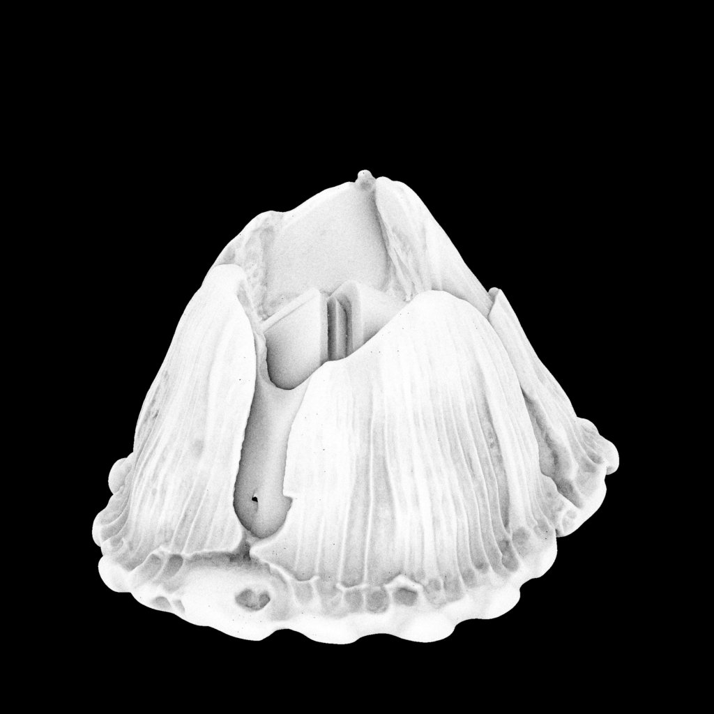

# 制作过程与来源

## 用户要求的演变

最初要求 20 × 20 cm 范围、最高 3 cm，大小不同、每颗不同，模拟附着在鲸鱼或海龟上的自然群落，并能逐颗从打印平台取下。早期规则化造型多次被认为不自然，之后尝试真实照片参考、扫描改制和 AI 图生三维。最后改为最高 15 mm，要求按比例缩小而非压扁。

## 路线与结果

| 路线 | 实际结果 | 是否进入最终模型 |
| --- | --- | --- |
| 早期程序造型 | 因形态重复、过于规则而继续迭代 | 未作为最终交付 |
| 第三方扫描改制 | 曾使用 pandelume 的 Single Barnacle，历史来源为 https://www.thingiverse.com/thing:25675 | 否，本仓库不收录其扫描文件 |
| AI 单颗图片、整盘概念图 | 得到方向参考图；原提示为最高 30 mm、约 45 颗 | 仅参考，不是最终形状或尺寸承诺 |
| Microsoft TRELLIS.2 | 生成预览成功，导出 GLB 时因 ZeroGPU 配额失败 | 否，没有取得可用导出模型 |
| 本地壳片重建 | 构造 50 颗独立模型，以 Blender 渲染预览 | 是 |
| 最高 15 mm 修改 | 保留各颗中心位置，XYZ 同比例缩小 | 是，当前发布版 |

TRELLIS 历史预览：

## 最终几何的具体做法

`src/build_original.py` 是原始重建算法：固定随机种子 71243，六个不等宽壳片区域，改变每片的高度、开口、倾斜和纵向纹理；部分模型包含从腔底连接的两片小盖板。底面封闭，互不相连。十颗主尺寸加四十颗较小尺寸，随机摆放并检测间距。

原重建版本先统一校正 Z 方向到最高 29.8 mm。随后 `src/scale_15mm.py` 对每颗使用同一个 XYZ 比例，围绕各自平面包围盒中心缩小至整盘最高 15 mm，保留原摆放位置。最终版本相对于 29.8 mm 定稿是等比例缩小；不能把前一阶段描述成扫描或纯 AI 输出。

## 已确认与未确认

已检查导出后的尺寸、闭合、正体积、50 颗分离、平面间距和文件完整性。闭合模型不等于所有打印机都能成功打印。尚未确认实际薄边成形、材料收缩、平台黏附力、耐用程度和剥离手感；也不宣称达到物种鉴定级精度。

历史网页资料可供研究：[鲸藤壶照片与描述](https://inverts.wallawalla.edu/Arthropoda/Crustacea/Maxillopoda/Cirripedia/Coronula_diadema.html)、[海龟附着生物文章](https://www.frontiersin.org/journals/ecology-and-evolution/articles/10.3389/fevo.2021.807237/full)。这些网页图片不随仓库分发。
