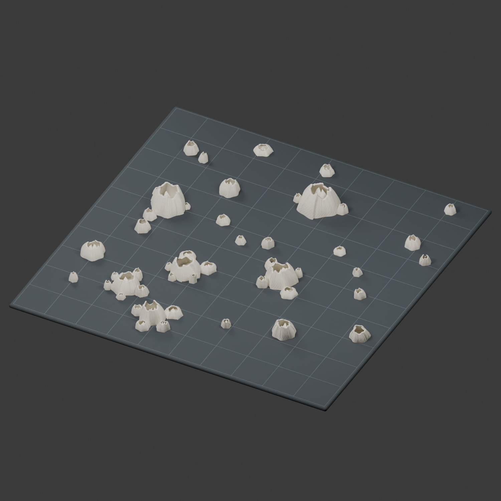
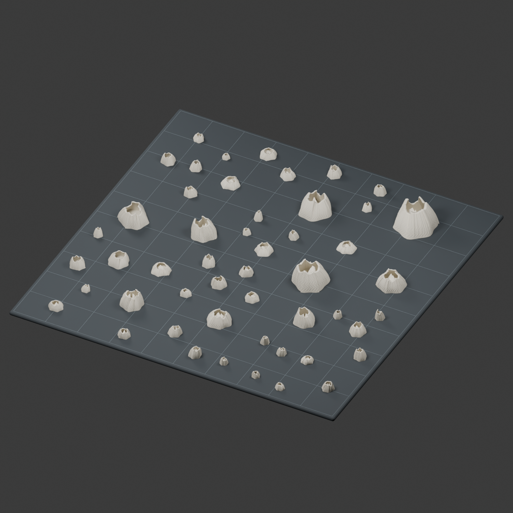

# 解压藤壶打印文件

这个项目的主要目的，是让大家 **把藤壶打印出来，再从打印平台上一颗颗或一组组撬下来，体验“撬藤壶”的解压乐趣**。这里的“解压”指放松解压，不是要求先解开压缩包。

这个文件夹直接放成品，不需要运行代码或重新建模。

## 选一个版本直接打印

| 版本 | 特点 | 整盘文件 | 先试打 |
| --- | --- | --- | --- |
| 独立版 | 50 颗各自独立，适合逐颗撬下 | [50颗整盘](01_独立版_50颗/整盘藤壶_最高15mm.3mf) | [三颗试打](01_独立版_50颗/先试打三颗_15mm.stl) |
| 群落版 | 30 颗分成 6 组相连群落，另外 20 颗独立，适合交替体验单颗与整组取下 | [群落整盘](02_群落版_30颗相连加20颗独立/整盘藤壶_30颗群落_最高15mm.3mf) | [5颗相连试打](02_群落版_30颗相连加20颗独立/先试打_5颗群落.stl) |

群落的数量分别为 **3、4、5、6、6、6 颗**，共 30 颗；相邻壳体实际连在一起。整盘共 26 件，没有共同打印底板。[群落版单独打印文件](02_群落版_30颗相连加20颗独立/单独打印/)包含 6 组群落和 20 颗独立藤壶，可自行选择。

两版都是 **200 × 200 毫米范围、最高 15 毫米**。整盘 3MF 是可直接导入切片软件的模型文件，不是压缩下载包，也不含特定打印机的现成打印参数；按自己的设备选择材料和设置。STL 使用毫米、100%大小。GitHub 文件页不能直接预览时，点击下载按钮或 View raw。

## 怎么体验

1. 下载试打文件，先打印少量，确认细节和取下时的手感。
2. 满意后打印整盘；完成并冷却后，按自己的平台使用方式取下，逐颗或整组体验。
3. 不要为追求更大的阻力强行撬伤平台或把手放在工具前方。

这里提供的是休闲创作，不承诺心理治疗效果。实际黏附与撬下手感取决于材料、打印参数和平台；目前完成了文件检查，尚未实物试打。

### 群落版效果（模型渲染，非实物照片）

### 独立版效果（模型渲染，非实物照片）

